# New Endgame Maps — Full Detailed Proposal

**Astral Citadel & Thor Volcano / The Primal Forge**  
**Map-preview completion pass · 15 October 2026**

## Resource budget update — 2026-10-15

The walking workshop now loads pixel-identical lossless WebP environment copies:
**2.29 MB for Astral / 2.82 MB for Thor**, instead of all 6.52 MB of PNG masters on
every opening. Stages reuse those images; the other map's unique texture is deferred
until selected. Native sprites and the approved Thor scene are unchanged. These
runtime files now ship through the in-game World Atlas scenery explorer; source/review files remain excluded. See the
[cloud-data audit](../CLOUD-DATA.md) for full storage/download/API scope and checks.

## In-game World Atlas integration — 2026-10-15

**Maps → Season 2 Maps → Astral Citadel / Thor Volcano** now opens the
reviewed scenery inside the game. It uses a visual snapshot of the player's saved
job/appearance, not a fixed demo Lord Knight. The existing field continues farming
separately; hidden field graphics are suppressed while the explorer is open.
Return to game or Escape closes/disposes the scene and restores focus. Stage
walking/overview/quick mode, destination switching and Thor inspection remain
available. Exploration is explicitly not a farming field: ten normal map IDs,
saved stage unlocks, combat/drop rules and the Monster Index remain unchanged.
Native mobs and live progression/rewards for these maps are still pending.

The publish adapter includes only runtime code, the lossless images/manifest and
renderer/license. It strips workshop/proposal links, never ships source PNGs or
captures, and makes the heavyweight scene lazy on opening. See
[actual game UI captures](game-ui-review/manifest.json) and the
[cloud-data audit](../CLOUD-DATA.md).

## Current completion status — non-mob map preview

The scenery/traversal **preview pass** is complete for inspection; this does not
mean production gameplay or combat is implemented. The owner allowed native mob
art to be left pending after another recovery attempt, so it is deferred rather
than replaced with invented monsters.

| Area | Current result |
|---|---|
| Connected Astral route and four progression zones | Complete in the preview |
| Small-detail overlay, native walking and camera follow | Complete in the preview |
| Quick/normal travel, pause/reversal and encounter-layout isolation | Complete in the preview |
| On-screen phone controls and keyboard navigation | Complete in the preview |
| Clickable route checkpoints and stage-specific inspection links | Complete in the preview |
| Loading/failure recovery, reduced motion and quality controls | Implemented and checked within the stated test scope |
| Approved Thor scenery/boss | Preserved |
| World Atlas UI entry, saved native appearance, isolated exploration/return | Integrated locally; not deployed and not a farming unlock |
| Native mob sprites/animation | Deferred after unsuccessful reachable-source checks |
| Live combat, progression, rewards, save integration and final balance | Not implemented by this preview |
| Physical-device performance and native-mob/skill readability | Not established |

### Final inspection controls

- Compact Previous / stage selector / Next / Pause / Route controls remain over
  the map on phones, so travelling does not require scrolling away from the view.
- **Whole bridge** shows four clickable progression checkpoints. Clicking one
  uses the same continuous travel, not scene replacement.
- Arrow keys change stages; Space pauses/resumes; Home / End select the first /
  boss stage. Focused form controls keep their normal keyboard behavior.
- Stage links such as `/tools/map_journey.html?map=astral&stage=7&view=overview`
  and `/tools/map_journey.html?map=thor&stage=10` open direct inspection views.
  These URL parameters are not account saves or gameplay unlocks.
- Arrival/pause feedback is announced without repeating every animation frame.
  The boss sanctuary automatically uses wider framing; closer framing remains
  optional. Quality controls reduce shadow/resolution cost when disabled.
- Environment-image loading has a twelve-second fallback bound; catalog loading
  has an eight-second abort bound. Material/catalog failure is visible and does
  not replace native mobs or permanently block the scenery review. Native
  character loading must still succeed before travel; it has an explicit retry.

Final source checks are recorded in [mob-source-checks.json](mob-source-checks.json).
The five inspected GitHub trees contained no matching required monster paths.
The hosted public renderer remains outside permitted outbound access. No new mob
art was downloaded; no claim is made that the mobs cannot exist elsewhere.

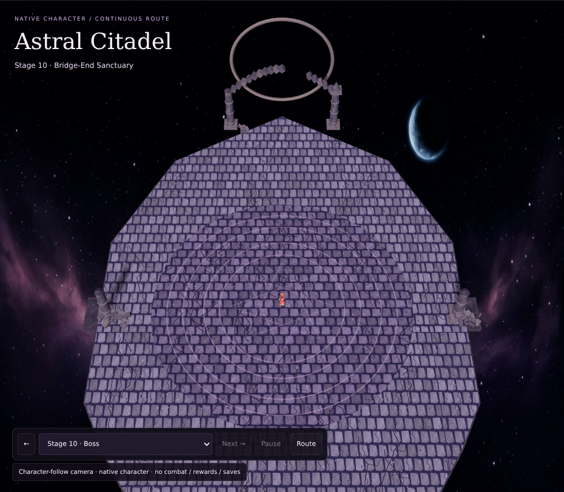

The current journey review package contains four actual render captures, including
this boss view, with matching source hashes. See [journey-review/manifest.json](journey-review/manifest.json).

## Latest follow-up — quick travel and encounter isolation

**Quick transitions** is on by default in the journey workshop. Adjacent trips
are brief; long unlocked trips target **3.5 seconds** of visible transition time,
instead of spending roughly twenty seconds walking from Stage 1 to Stage 7.
Turn the option off for the original 6.5-unit/second detail-inspection walk.
Speed is recalculated from the remaining route when retargeted or when changing
modes. Pausing preserves both position and destination. This does not change
combat speed, native animation frame timing, stats or live progression gates.

The camera and character still follow the connected deck; no scene reload or
teleport is introduced. Quick travel uses visible wall-clock deltas rather than
the capped normal-walking clock. Hidden-tab resumption resets the page clock;
a large visible stall is bounded rather than skipping the entire route.
In the actual software-rendered browser check, Stage 1 → Stage 7 arrived in
5.249 seconds and the camera settled by 6.156 seconds. This is not a guaranteed
physical-device timing: 3.5 seconds is the intended transition target, not a
claim that every renderer/frame rate achieves it exactly.

### What happens to encounters

Implemented **layout lifecycle** in this prototype:

- Selecting another stage clears the old active layout immediately.
- While travelling or paused mid-route, there are no active spawn slots/markers.
- Passing intermediate stages updates route position only; it does not activate
  their encounter layouts or grant stage completion.
- Only the chosen destination's layout is prepared on arrival. Reversing and
  returning within the same stage restores that stage's layout on arrival too.

For actual gameplay integration, the intended rule is: disengage the old fight,
remove its enemies/escorts and in-flight attacks **without kill credit, drops or
EXP**, then create a fresh destination wave on arrival. An abandoned boss resets
to full HP; travelling must not preserve chip damage or count as a boss kill.
Already-confirmed kill rewards stay earned. Travel must not reset player skill
cooldowns or clear buffs/debuffs for free. Pets should follow rather than fight
across stages. These combat rules are **not implemented by the layout prototype**.

### Other native mob sources

The public [ragassets renderer](https://github.com/adsonpleal/ragassets), pinned at
`4de4fa747431979d35c747d7edd549a872efd9e1`, documents a free public image service
and original-animation PNG/APNG or PNG-ZIP export. Its hosted asset domain is
outside this workspace's permitted outbound hosts, and its GitHub test fixtures
include Poring rather than the twelve required new-map monsters. Availability of
the exact twelve mobs at the hosted service has **not** been verified.

An authorised native GRF/resource pack is one input route. A complete verified
native export pack is another: all supplied actions/directions, unchanged pixels,
frame timing, common-canvas placement/foot anchor, identity and provenance. Raw
ACT/SPR files are therefore not the only acceptable recovery path. Do not use
unverified single GIFs, repaint existing mobs, or depend on a hobby image server
for production runtime loads. Once recovered, export/audit and ship locally.

## Latest building pass — native character traversal and small detail

Open `/tools/map_journey.html`, or **Walk the detailed bridge with a native
character** on the comparison board. This is a separate development prototype;
the scenery-only studio remains available for the approved baseline compositions.

- All ten Astral stage buttons now request **continuous walking**, not map swaps.
  The camera follows the actual character. Selecting a distant stage passes the
  intervening stage locations; selecting behind the character reverses direction.
- Stage changes happen on arrival. Pause/resume preserves position. No Astral
  scene rebuild occurs during travel. All stages are unlocked for review only;
  there is no implemented progression gate, combat encounter or reward trigger.
- The existing audited native Lord Knight pack supplies idle/walk actions,
  directions, foot anchor, layers and native frame delays. Source files and pixels
  are unchanged. Character loading verifies the existing pack's lengths/hashes;
  a failure blocks travel and offers retry rather than drawing a replacement.
- A separate Astral overlay adds **566 detail pieces / 12,616 triangles**: fine
  brass edge seams, inset route arrows, compass engravings, chipped stone
  fragments, small luminous fixtures, cantilever brackets, hanging chain links,
  torn pennants and fine radial sanctuary inlay. Debris and fixtures stay clear
  of the full travel corridor; flat engraving is not an obstacle or damage hazard.
- Cloth/atmosphere motion can be disabled. Follow, whole-route and closer framing
  are available. Thor receives no overlay and retains its approved scenery.
- Deterministic encounter layouts cover all twenty destination/stage combinations.
  The visible roster uses the candidate native identities. Optional labelled
  rings show **planned spawn positions, not actual mobs**.
- **Animated mobs remain incomplete.** The twelve matching ACT/SPR pairs and
  authorised provenance are still missing. No native mob images or animation
  have been recovered by this pass, and no generated substitutes are used.

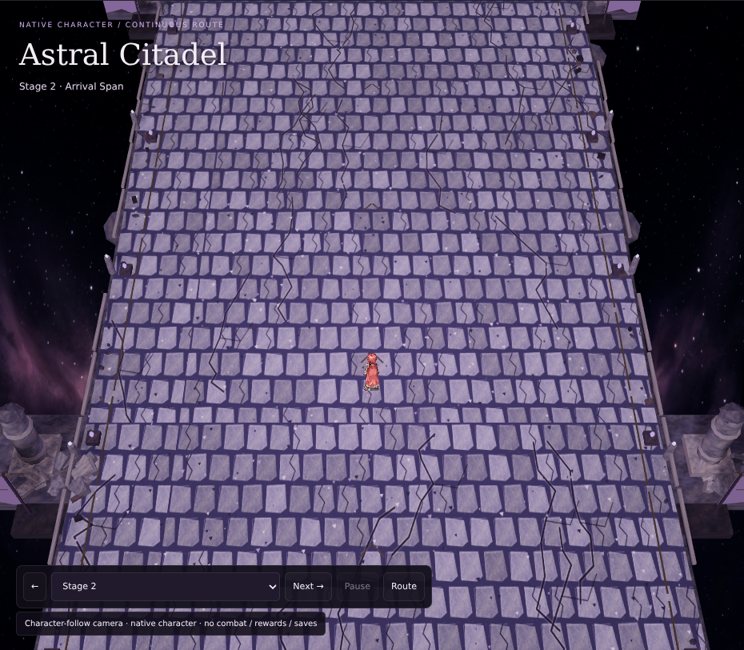

Actual whole-route and Thor captures are also in `journey-review/`. Its manifest
pins the journey, baseline scenery, native loader/catalog and render sources.
Software-WebGL checks validate travel and rendering, not physical-device FPS,
finished fighting, native mob readability or live map integration.

The sections below retain the full layout/economy proposal. The earlier
camera-only tour in the scenery studio is separate from this new walking prototype.

## 1. Correction after the latest review

The previous separate stone rooms missed the owner's concept. **Astral is a
floating bridge through space, with the boss fight at its far end.** It is not four
detached platforms, and extra cracks do not fix the wrong overall structure.
The owner approved Thor's boss scene; that scene is preserved.

Stage grouping stays **1–3 / 4–6 / 7–9 / boss 10**, but Astral's groups are zones
along **one uninterrupted bridge**. Thor's ordinary stages use natural volcanic
fields rather than boxed masonry fighting floors.

Available now: actual 3D scenery, an entire-route overview, a camera journey along
the bridge, eight local inspection views and updated render captures. These are
visual proposal tools, not playable travel, character movement or combat.

## 2. Inspect the whole journey

- **Comparison board:** `/tools/map_scene_review.html` — whole-route hero image,
  eight section captures, direct inspection links and this complete proposal.
- **Whole Astral bridge:** `/tools/map_scene_preview.html?map=astral` — starts with
  the entire bridge visible and the four progression zones labelled.
- **Follow bridge → boss:** a 28-second camera tour from arrival toward the end
  sanctuary. It moves the camera only; there is no simulated player or fight.
- **Stage buttons:** inspect the matching section of the same bridge. They do not
  swap it for another island. **Whole bridge** restores the full-route overview.
- **Approved Thor boss:** `/tools/map_scene_preview.html?map=thor&stage=10`.
- **Presentation view** shows scenery; **Game camera** retains the existing game's
  projection/elevation/distance formula. Neither is a playable build.

The optional bounds guide is a proposed clear encounter zone, not a visible room
wall. Astral translates it along the bridge for inspection only. No current-game
movement/spawn limits or save data are changed.

## 3. Shared graphics contract

- Cracked paving, chipped masonry, loose rubble and worn stone on the bridge.
- Suspended thin deck, slender edge rails, ruins and celestial details beside the
  route rather than giant stone boxes underneath each encounter.
- Space backdrop with stars, restrained violet nebula and a distant crescent world.
- Irregular volcanic ground, branching fractures, crusted molten pools, spilled
  lava, cascades, basalt outcrops and cooled debris for Thor.
- Large loose pieces remain outside the selected clear encounter zones. Small
  surface damage is flat decoration, not an untelegraphed obstacle or damage hazard.
- Original generated environment artwork is separate from native sprite assets.
  No monster sprite pixels have been replaced, recoloured or invented.

## 4. Astral Citadel — one connected floating bridge

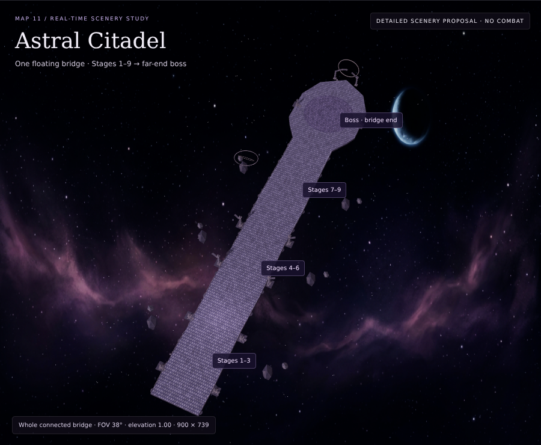

The deck runs from z +24 to a pointed end at z −245, with no gaps in the central
path. Most spans are about 30 units wide. After z −177 the bridge widens gradually
into its attached end sanctuary; this is not a detached circular boss island.
The same entire route is built for every selection. Only inspection focus and
selected-zone metadata change.

| Stages | Zone | Inspection focus | Visual landmarks |
|---|---|---:|---|
| 1–3 | Arrival Span | −8 | Broken low arrival pillars, slender rails, open astral void |
| 4–6 | Ruined Crossing | −74 | Taller ruined gate pylons, crumbling edge masonry and buttress remnants |
| 7–9 | Celestial Approach | −140 | Luminous edge inlay, floating celestial armillary, sanctuary ahead |
| 10 | Bridge-End Sanctuary | −208 | Widened pointed terminus, flat ceremonial seal, broken celestial gate |

### Arrival Span — Stages 1–3
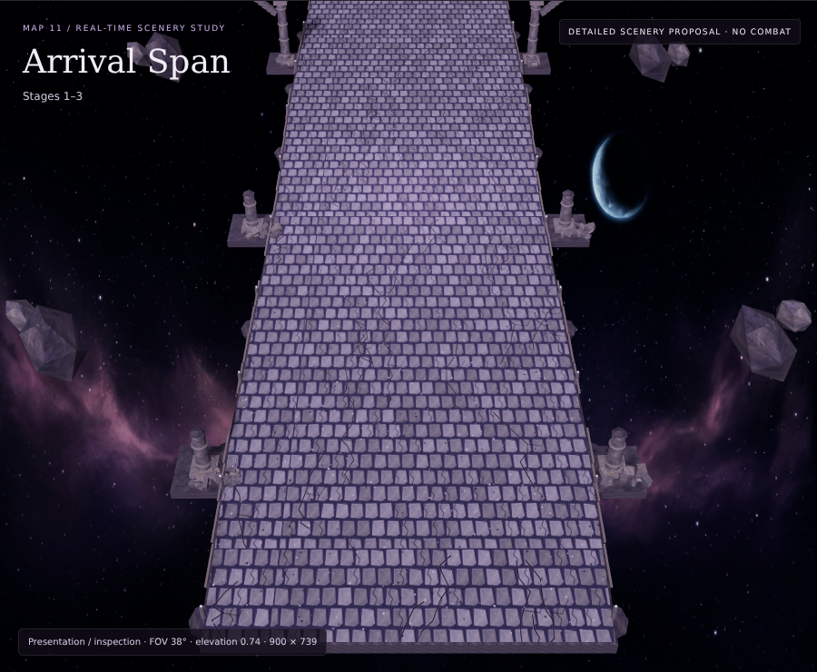
The approach reads as a long suspended route continuing into space, not a square
terrace. Small outer fragments are distant debris, not additional combat rooms.

### Ruined Crossing — Stages 4–6
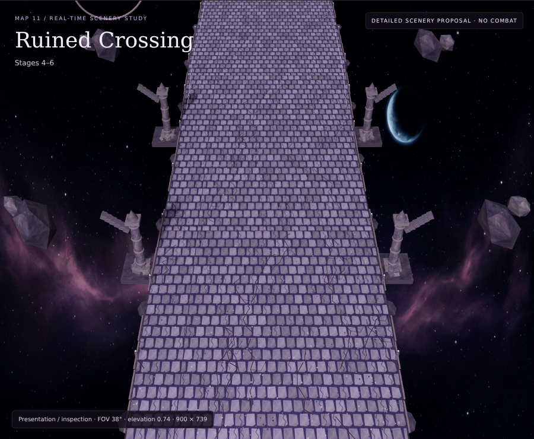
Ruined edge architecture gives the middle span a different silhouette without
interrupting the continuous paving or enclosing it as a cathedral nave.

### Celestial Approach — Stages 7–9
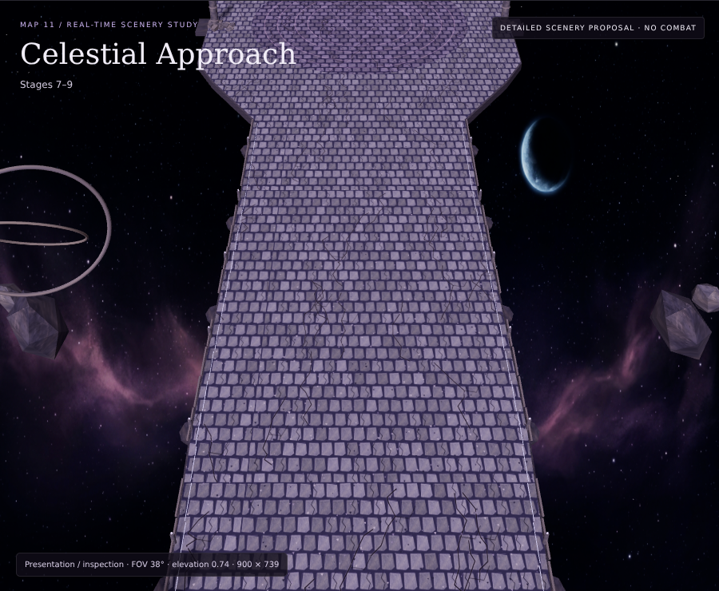
The final long span leads directly into the sanctuary. Edge inlay and an off-route
armillary establish the celestial landmark without putting solid clutter in the lane.

### Bridge-End Sanctuary — Stage 10
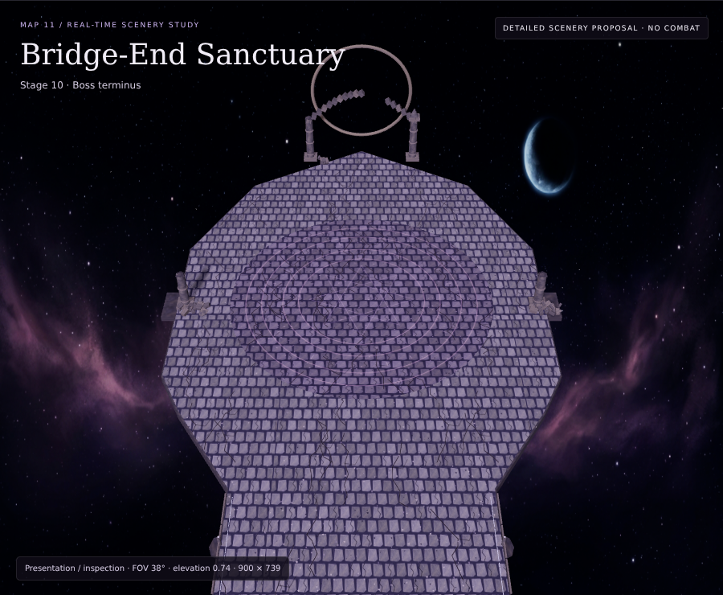
The route flares into a broader ceremonial end. A round seal is flat ornament on
the connected deck, **not the walkable floor's footprint**. The approach remains
attached and visible. Planned MVP: Memory of Thanatos; native artwork is pending.

For inspection, clear zones use x ±13 and focus z ±20. These rectangles move with
the selected zone; polygon-containment checks ensure they remain supported by the
bridge. Eventual real traversal/encounter behavior still needs gameplay design and
integration; the camera tour does not implement it.

## 5. Thor Volcano — natural fields, approved boss retained

The three ordinary groups now use irregular fractured ground without rectangular
raised plinths, straight fighting-box curbs or masonry-grid floors. Crusted molten
pools sit visibly around the terrain edges. The existing clear zone x ±13,
z −28…+12 remains available for later integration.

### Outer Fissure — Stages 1–3
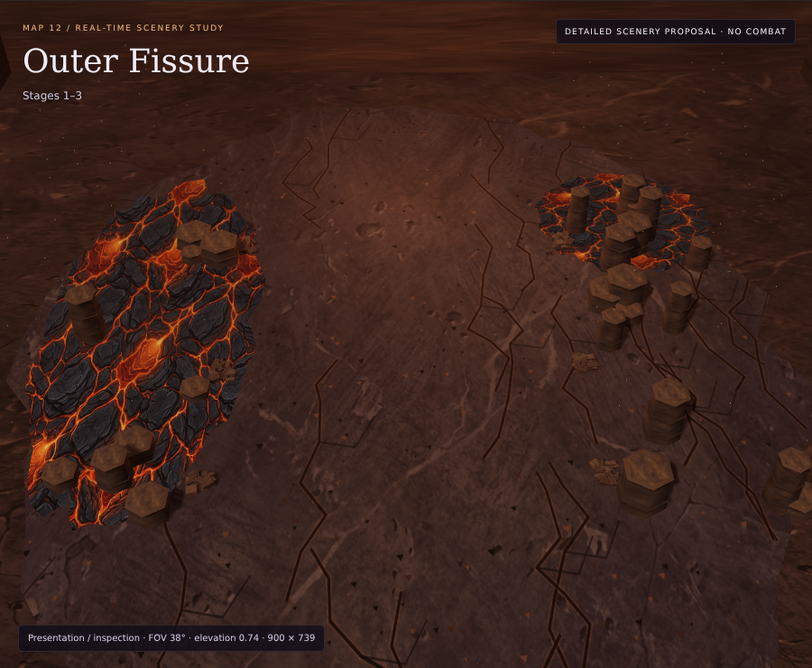
Open cooled-lava terrain, an asymmetric fissure, scattered short basalt outcrops,
loose volcanic rubble, cooled spill tongues and branching fractures.

### Magma Gallery — Stages 4–6
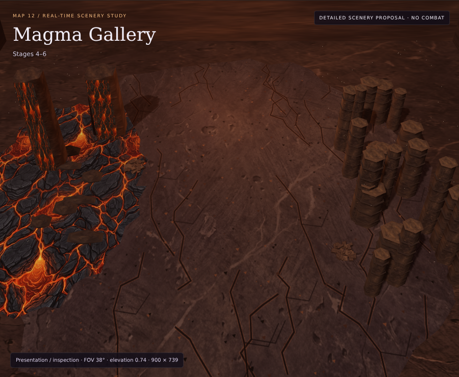
A broad one-sided basin receives two lava cascades. Crusted islands and a sheared
basalt cliff oppose it; the ground is a field, not a tiled rectangular chamber.

### Core Approach — Stages 7–9
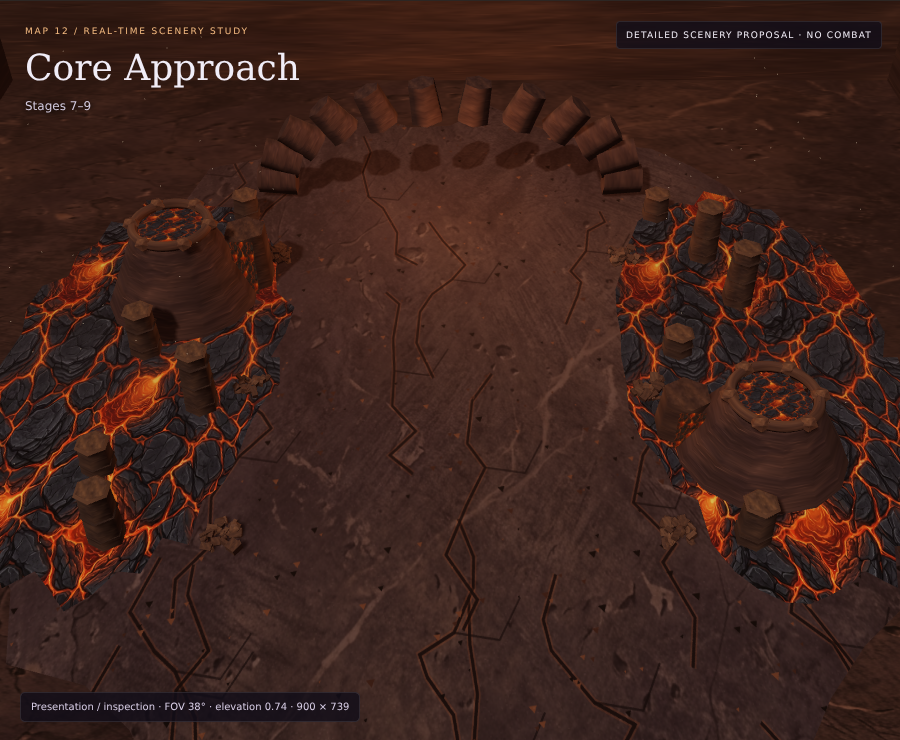
Two active side calderas, broken obsidian ribs, outflows, loose rock and severe heat
fractures form the deeper volcanic approach.

### Primal Core — Stage 10 / approved design preserved
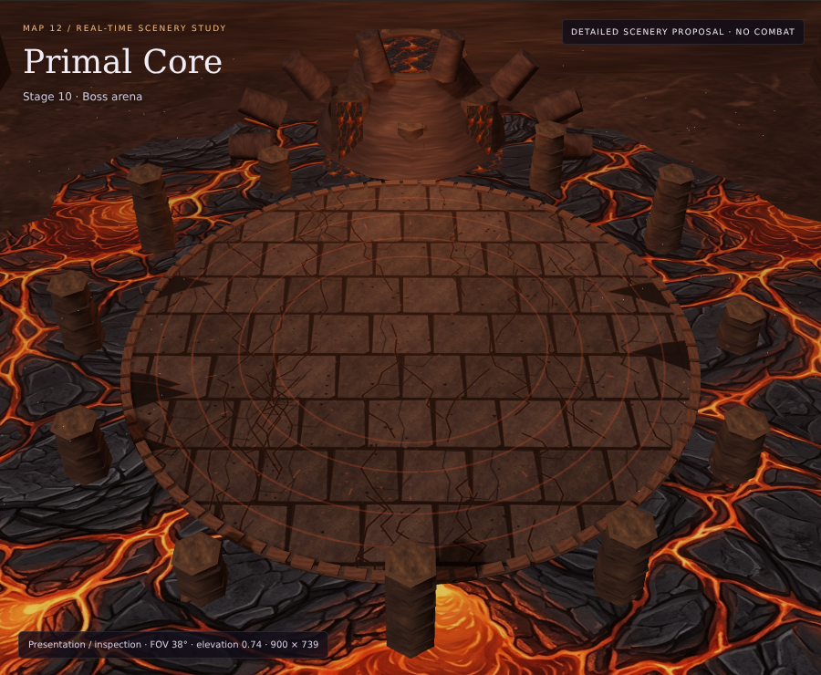
The 54-unit circular obsidian dais, supporting plinth, broad lava lake, radial
basalt crown, giant rear caldera, materials, lighting and presentation framing
are retained. A regression fingerprint guards its mesh geometry, instance
transforms and material colours. Its radius-27 disc contains the existing clear
rectangle. Planned MVP: Ifrit. No boss AI or native animation is implied.

## 6. Monsters — complete intended direction and current limitation

High-quality scenery should be paired with authentic native monster art, not generic
recoloured enemies. The planned roster remains:

| Astral Citadel | Thor Volcano |
|---|---|
| Retribution Angel | Magma Slag |
| Despair Phantom | Fire Imp |
| Tower Watcher | Kasa |
| Death Whisperer | Salamander |
| Agony Demon | Obsidian Golem |
| **Memory of Thanatos — MVP** | **Ifrit — MVP** |

Twelve candidate original identities have been checked against pinned rAthena
metadata. Native identity candidates, mismatches and source requirements are
recorded in the [mob art plan](MOB-ART-PLAN.md). Identity metadata is **not** sprite art.

**Unresolved external input:** the matching original ACT/SPR files are not in the
checkout, and the established native-source host is outside permitted network
access. Source recovery is still required. The scenery work does not pretend to
solve that by generating, recolouring or substituting monster sprites.

After recovery, preserve native pixels, supported directions, action metadata,
anchors, frame order and delays; inspect idle/walk/attack against both floor palettes.
Some speculative roadmap names/roles may need review to fit genuine native art.
Do not append pets or reinterpret saved numeric species as part of that work.

## 7. Progression and encounter proposal

These are proposed behavior rules, not implemented by the scenery studio:

- Astral entry: Base Lv 140 plus Abyss normal Stage 10 cleared.
- Thor entry: Base Lv 150 plus Astral Stage 10 cleared.
- No entry fee; previously cleared stages remain available for farming.
- Normal stages 1–9 use the appropriate shared environment and existing farm loop.
- Stage 10 is an immediate MVP encounter with escorts, not another trash threshold.
- No new Nightmare stages in the first release.
- Both destinations must be viable for current Transcendent classes; do not require
  unimplemented third jobs, Ascension stats or Mythic equipment.

Exact HP, ATK, EXP, Zeny, escort composition, cards and gear tables still require
real combat/economy benchmarks. Preserve original map indices; append internal
indices 10 and 11. Audit existing ten-map assumptions, Nightmare token pickers,
auto-advance and save-array repair before enabling travel.

## 8. Material economy — much rarer than the first proposal

| Material | Source | Provisional chance per eligible kill |
|---|---|---:|
| Astral Shard | Astral Citadel | 0.035% |
| Primal Catalyst | Thor Volcano | 0.035% |
| Valkyrie's Sigil | Ordinary mobs/escorts in either map | 0.0025% |
| Valkyrie's Sigil | Stage 10 MVP | 0.1% |

These recommendations are **100× below the initial proposal**, not implemented
live rates. At these odds, expected kills per success are approximately 2,857 for
a crafting material, 40,000 for an ordinary-mob sigil and 1,000 for an MVP sigil.
They are expectations, not guaranteed payouts or a pity system. Measure kills/hour
before fixing the final economy.

Use a shared sigil initially, with map-specific common materials. Roll independent
material outcomes only on confirmed kills, never on escorts despawned after MVP
clear. Do not accidentally inherit pet gear/ore bonuses. Add safe account-owned
counters separate from equipment and `nmMat`, protected from autosell.

The future consumers—class glyphs and boss summoning—must be labelled as future
content until implemented. Ascension Core odds are not specified here. Offline
materials require a separate server-safe design; preserve current measured
EXP/Zeny away-income rules in the meantime.

## 9. Technical graphics specification

- One deterministic full Astral route shared across all stage selections; separate
  deterministic Thor field compositions. All resources load locally.
- Damaged 2048² ground surfaces, original weathered-stone/crusted-lava materials,
  and an original astral-space backdrop. The viewer announces material fallback.
- Instanced repeated masonry/rubble/basalt, bounded 96-point atmosphere and explicit
  disposal of geometry, materials and textures on switching.
- Reduced-motion preference is respected. The tour requires an explicit click;
  static review renders only when changed. Hidden tabs pause rendering.
- Route overview uses an appropriately adjusted clipping range to avoid distant
  deck/support depth fighting. The current-game camera remains separate.
- Actual Chromium WebGL captures and a source/material/image hash manifest are
  published in `scenery-review/`. They are renderer output, not concept paintings.
- Software-WebGL tests are not proof of physical-device frame rate or native
  sprite/skill-effect readability. Production publishing excludes this tooling.

Original images in `environments/` remain historical atmosphere studies, not the
current layout specification. Revision 2's detached Astral rooms are superseded.

## 10. Remaining work before a playable release

1. Recover authorised native mob files; audit directions, actions, placement and timing.
2. Integrate the development traversal prototype into actual gameplay, with
   progression gates, combat-safe transitions and encounter activation on arrival.
3. Integrate map travel, gates, MVP escorts, Monster Index/cards and reviewed gear tables.
4. Add save-safe materials/drop messaging and regression coverage without changing
   existing identities or saved numeric ordering.
5. Benchmark current-class progression/economy and finalise combat/reward values.
6. Validate native sprites and dense skills against the scenery on real hardware.
7. Bump the game build and pass the full push gate when actual gameplay is delivered.

## 11. Acceptance criteria for this visual revision

- Astral reads as **one floating bridge in space leading toward the boss**.
- A full-route overview shows all four connected progression zones together.
- Stage selection retains identical complete Astral route geometry.
- The boss terminus is attached to that route, not an isolated round or square island.
- Thor's ordinary fields have organic ground silhouettes rather than fighting boxes.
- Approved Thor boss geometry/material colours are unchanged under regression checks.
- Selected clear zones are supported by ground and kept free of solid clutter;
  below-floor support/lava must actually stay below the floor.
- Cracks, rubble, loose masonry and volcanic spills remain present.
- Native sprites, live balance, saves and production gameplay remain untouched.
- Geometry/lifecycle/viewer/package tests and actual browser checks pass. Visual
  inspection is separate from performance validation and final owner acceptance.

## 12. Delivery status

**Scenery proposal:** revised locally for full inspection.  
**Live review:** native-character walking prototype with small detail, plus the
scenery studio, eight local views and full comparison board.  
**Native monsters:** awaiting authorised original files; no substitutions.  
**Live gameplay / animated mobs / final balance:** not implemented.  
**Commit, push or production deployment:** none for this revision.
