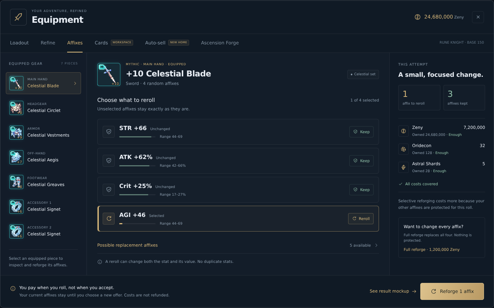
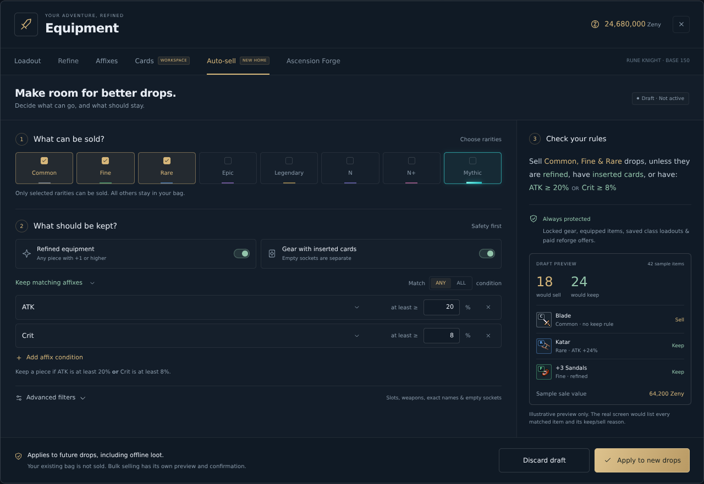
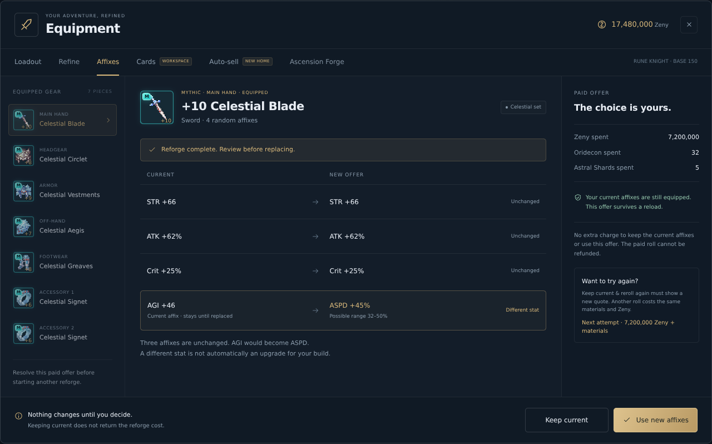
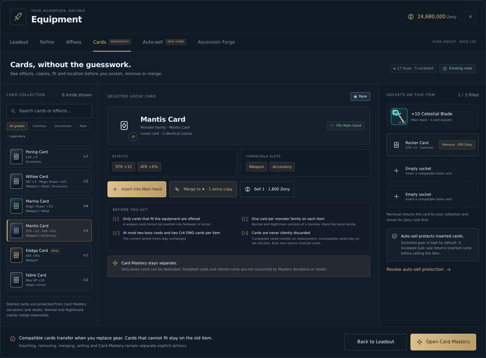

# Equipment Workbench — visual proposal

**26 October 2026 · For approval, not applied to the game.**

A more readable equipment screen in Horizon Haven’s existing **Eclipse navy-and-gold theme**. The focus is affixes and auto-sell, with a dedicated card workspace: show one decision at a time, explain what will happen, and make expensive or destructive actions unmistakable.

## See the visuals

- **[Six-page visual proposal (PDF)](equipment-redesign-proposal.pdf)** — affixes, auto-sell, reforge result, loadout, cards and phone layouts.
- [Design direction with annotations](00-design-direction.png)
- [Loadout](01-loadout.png)
- **[Affixes](02-affixes.png)**
- **[Auto-sell](03-auto-sell.png)**
- [Paid reforge result](04-reforge-result.png)
- [Affixes — phone](05-affixes-phone.png)
- [Auto-sell — phone](06-auto-sell-phone.png)
- [Loadout — phone](07-loadout-phone.png)
- **[Cards workspace](08-cards.png)**
- **[Cards — phone](09-cards-phone.png)**

**Latest revision — Mythic color and card system:** Mythic now uses a bright **cyan** rarity badge, visually separate from Legendary gold. Its badge also has a distinct filled gradient and cut corner, while keeping the readable `M` code and full name. Added a dedicated **Cards** workspace to the proposal, covering collection, grades, compatible slots, sockets, merge costs, socket limits, replacement safety, Card Mastery and auto-sell protection. The refreshed PNGs and six-page PDF include these changes; the live game is still unchanged.

These are actual Chromium captures of **static visual mockups**, not AI-painted interface text or a running gameplay capture. Equipment, wallets, stats, preview counts and offers are illustrative. The example reforge prices and affix ranges are checked against the current game helpers.

### Open the review

```sh
PREVIEW_PAGE=tools/equipment-proposal/index.html python3 tools/preview_server.py 8000
```

The **Equipment design proposal** live preview opens this review. Use its five numbered links and Desktop / Phone buttons to inspect the mockups. The game controls inside the visuals are deliberately non-functional illustrations; this is not a working equipment replacement. The existing game remains separately accessible at `/game`.

## 1. Affixes: a focused workbench



**Current friction:** `reforgePanel()` stacks every equipped item, its affix buttons, pool disclosure, prices and any paid offer. It is difficult to distinguish selection, protection, payment and acceptance at a glance.

**Proposed:**

- Rename the visible Reforge tab to **Affixes**, keeping reforging inside it.
- Pick one equipped item in a compact sidebar. On phones, use a full-width gear picker instead.
- Show four readable affix rows for the example Mythic piece: three green **Keep** rows and one gold **Reroll** row. Normal pieces retain their existing affix counts.
- “Keep” means unchanged **for this attempt**; it is not a new permanent affix lock, resource or protection purchase.
- Show the current stat’s range and its position within that range. This is not a chance of success, quality percentile or promise of rolling the same stat type.
- Put the complete Zeny, ore and material quote in one place, with owned amounts and shortages.
- Give the selected reforge one primary action. Keep Full reforge as a clearly separate alternative, warning that all affixes change.
- State the non-refundable payment timing before the player rolls. A roll can change both stat type and value; the current item is not overwritten until acceptance.

The static example is a Mythic Celestial sword at `sec=6, tier=4, mp=0`. Its STR/AGI ranges are 44–69, ATK 42–66%, Crit 17–27%. A single-affix reforge currently costs **7,200,000 Zeny + 32 Oridecon + 5 Astral Shards**; full reforge is **1,200,000 Zeny** without those selective material fees. This proposal does **not** change these prices.

## 2. Auto-sell: sell these → keep these → review



**Current friction:** auto-sell is nested under the inventory’s selling disclosure, then another filter disclosure. Fourteen affix checkboxes and minimum fields appear together, alongside equipment filters and both automatic/bulk sale controls.

**Proposed:**

1. **What can be sold?** Eight clear rarity choices. Only selected rarities are eligible.
2. **What should be kept?** Familiar protections for refined equipment and gear with inserted cards. Add only the affix conditions the player needs, instead of exposing 14 unused inputs.
3. **Check your rules.** A plain-English summary and a preview showing why each example would sell or stay.

For the example: **Sell Common, Fine and Rare drops unless refined, containing inserted cards, or having ATK ≥20% OR Crit ≥8%.**

- Explain **ANY** as “or” and **ALL** as “and.” Keep the alternate **Sell matching affixes** mode available through the action picker; make its opposite meaning explicit, rather than silently inverting the rule.
- Put equipment slots, weapon families, exact names, empty-socket thresholds and the existing draft preset shortcuts in Advanced. Retain the existing category matching rules and non-weapon protection when a weapon family is selected.
- Keep the **always protected** list visible: locked gear, equipped items, saved class loadouts and paid reforge offers.
- Give Auto-sell a first-class Equipment entry. Bag should link to this same settings view, not create a second rule set.
- **Proposed interaction change:** rarity choices and filters are one explicit draft, applied together with **Apply to new drops**, rather than arming a rarity immediately during editing. Retain a clear pause/turn-off-all control for an already active configuration.
- Applying rules affects future online/offline drops; it never sells existing bag items. Existing-bag bulk sale remains a separate entry with its own rarity selection, exact preview and confirmation.
- A future real preview can evaluate the draft without paying or selling. The mockup’s **42 sample items / 18 sell / 24 keep / 64,200 Zeny** are fixed visual examples, not an actual matcher result.

## 3. Reforge result: compare before replacing



- Display Current and New offer side by side, marking unchanged rows neutrally.
- Highlight only the offered change. AGI → ASPD is a **different stat**, not automatically “better”; do not invent a DPS comparison.
- Show the amount already spent, the fact that keeping the old affixes is not a refund, and the fact that the offer survives reload.
- Separate **Keep current** from the primary **Use new affixes** decision. Any keep-and-roll-again shortcut must display a fresh quote and pay again.

## 4. Cards: collection, compatibility and safe sockets



**Yes, the card system is in the proposal.** Previously it appeared only as a small card-socket summary and an auto-sell protection. It now has its own **Cards** tab and a full desktop/phone layout, while keeping the existing game rules rather than inventing a second card economy.

- Show the collection with search, grade filters, effects, compatible slots, copy counts, family, boss status and whether a card is loose or socketed.
- Show the selected card’s exact effects, fit, duplicate copies and actions: **Insert**, **Merge to ★**, **Sell**, plus a separate route to **Card Mastery**.
- Show the selected item’s 3 sockets, one inserted card and two empty slots. Removal displays `200 × (grade + 1)` Zeny and returns the card to the collection.
- Keep the current limits explicit: one card per monster family per item, at most two boss cards and at most two Crit DMG cards per item. Normal and Nightmare versions of a monster share a family; only cards that fit the equipment can be inserted.
- Preserve card ownership: compatible cards transfer when equipment is replaced, incompatible cards stay on the old item and a reviewed bulk sale returns inserted cards. Auto-sell keeps socketed gear by default.
- Keep Card Mastery separate: only loose, unstarred cards can be dedicated. Socketed and starred cards are not consumed by Mastery donations or resets.
- The sample card names, grades, effects, fits, family names, boss flags and values come from the current catalog. Merge step 1 consumes **1 extra unstarred copy** for +9% effects; steps 2 and 3 consume 3 and 5 extra copies.

This is a static interface proposal. It does not change card drop rates, effects, socket counts, merge costs, Mastery rewards or save data. The card examples are illustrations, not an account’s inventory.

## 5. Overall equipment home and phone behavior

Keep the recognizable hero / inventory / selected-item inspector structure. Improve the text size, item spacing and action hierarchy rather than switching to a new visual language. Refine and Ascension Forge stay available; they are not redrawn in this study. Add Cards as an Equipment-level workspace, linked from the loadout socket summary. Retain keyboard shortcuts and all current equipment/card/refinement actions during integration.

The visual study uses the current `#101b27` / `#131d29` navy surfaces, `#d7b77a` gold, DM Sans and Manrope fonts, subtle borders, original equipment icons and an original native Rune Knight pose rendered through the unchanged wardrobe modules. No sprite or equipment artwork is repainted or recoloured. The character is positioned using its visible pixel bounds rather than the transparent source-frame padding; its original proportions and displayed scale are preserved, with its ground contact on the preview ring.

**Equipment rarity badges:** A small top-left chip uses a readable code: **C** Common, **F** Fine, **R** Rare, **E** Epic, **L** Legendary, **N** Nightmare, **N+** Nightmare+ and **M** Mythic. Full names appear in the inventory key and native tooltips/accessibility labels, so color is not the only identifier. Legendary remains gold (`#ffd26e`), while Mythic is now a distinct cyan (`#3ddad9`) drawn from the existing blue/teal accent family, with a filled gradient badge and cut corner. The Mythic color has >10:1 contrast on the dark panel and >7:1 contrast for its dark badge text. The badge uses explicit item-rarity fixture data—not the icon image, refinement rank or selection highlight. It remains separate from the top-right lock and bottom-right `+rank`; empty slots have no badge. The auto-sell examples correctly carry C / R / F badges.

Below 580px, columns stack rather than shrinking the desktop UI. Affixes get a compact gear picker; the quote follows the affix rows. Auto-sell uses four rarity options per row, full-width protections, then the summary. Cards stack collection, selected card, rules and sockets. The phone captures are full scrolling documents for review. **When integrated**, the game needs a viewport-bounded panel, independently scrollable content and a reachable bottom action bar, including on short-height desktops.

## Scope and integration safeguards

- No edits to `index.html`, `assets/`, `functions/`, migrations, saved formats or BUILD. New proposal files are under `tools/` and `docs/`, excluded from production publishing by the existing assembly rules.
- No account access, localStorage reads/writes, API calls, actual sales, rolls, currency deductions or gameplay updates. Only review navigation and read-only local artwork loading work.
- Reuse the existing authoritative matcher and quote helpers rather than copying/rebalancing them. Preserve live/offline parity, auto-sell-before-auto-equip ordering, item IDs, saved loadout protection and account ownership.
- Preserve old/saved affixes outside current ranges; label them instead of clamping. Affix minimums must keep their current stored-roll meaning. HP needs explicit raw-roll versus effective ×2 wording; zero means any roll of the selected stat.
- Preserve quote revalidation, affordability checks and existing missing-material purchase confirmation. Mythic materials must not be silently auto-purchased. Keep paid offers intact across reloads, unequipping and account changes.
- Bulk previews must list exact item IDs, recheck current rules/protections at confirmation and never include later unrelated drops. Draft preview is advisory, not permission to sell.
- This is a **design direction awaiting approval**, not production integration or a balance proposal.

## Files and verification

- `tools/equipment-proposal/index.html`, `proposal.css`, `proposal.js` — static visuals and review navigation.
- `tools/equipment-proposal/review.html` — six-page print review.
- `tools/check_equipment_proposal_browser.cjs` — reproducible browser checks and captures.
- `tools/check_equipment_card_system.cjs` — real game-helper/action checks for the current card system.

```sh
npm install --no-save --package-lock=false playwright @sparticuz/chromium jsdom three@0.128.0 ws
node tools/check_equipment_proposal_browser.cjs http://127.0.0.1:8000 --capture
node tools/check_equipment_card_system.cjs
```

**Verified after the Mythic-color/card-system revision:** 19 browser checks cover the static-only boundary, real-helper ranges/prices, real card-catalog examples, distinct/accessibility-checked Mythic cyan, rarity coverage, protection/selection wording, paid-offer decisions, native art loading, review navigation, the Cards workspace and 30 screen/viewport combinations at **320, 390, 768, 1024, 1280 and 1440px**. The dedicated card-system check passes 8 action-level checks using the game’s real helpers: catalog definitions, collection rendering, compatibility/socket limits, insertion/removal/fee, replacement transfer, merging, Card Mastery protection and auto-sell/bulk-sale card safety. The visible character pixels remain centered, grounded and clear of equipment slots without aspect distortion. All occupied equipment tiles have the correct grade badge; badges stay inside their tiles and do not collide with lock/refinement markers. Empty slots remain badge-free. No horizontal document overflow, clipped checked labels, action collisions, page errors, failed asset requests, API submissions or persistence access were found. The PDF has six pages with notes inside their page footers.

Card-related suites also pass: `card_sim` (13), `card_comparison_sim`, `card_star_balance_sim`, `drop_card_sheet_sim` (14), `equipment_cards_sim`, `gear_sim` (43), `crit_sim` (6), `save_load_sim` (27), `autosell_sim` (13), `ui_sim` (64), `eclipse_ui_sim` (52), `equipment_selection_sim` and `update_watch_sim` (9). `card_star_balance_sim` needed its documented historical Git commit fetched into this shallow checkout; after that, it passed. JavaScript syntax, whitespace and unchanged-runtime checks pass. The full pre-push gate, actual cloud/account behavior, live game integration and physical-device performance were not tested; no push or deployment was requested.
