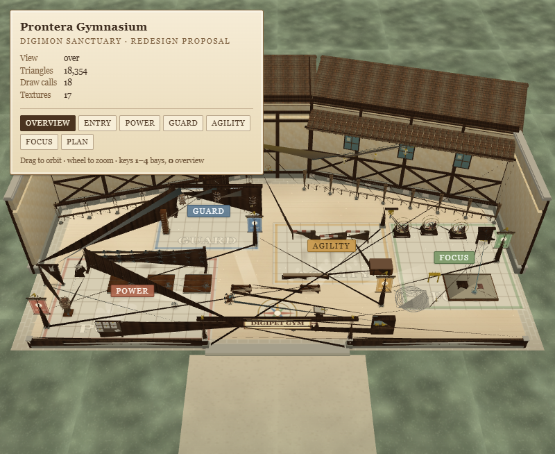
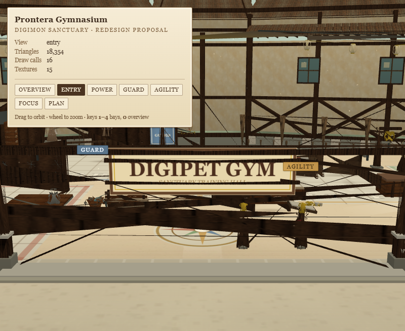
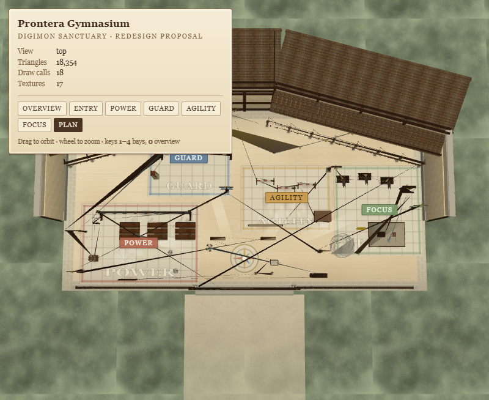
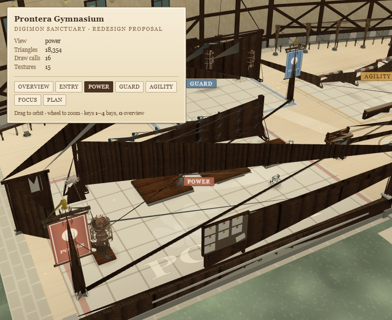
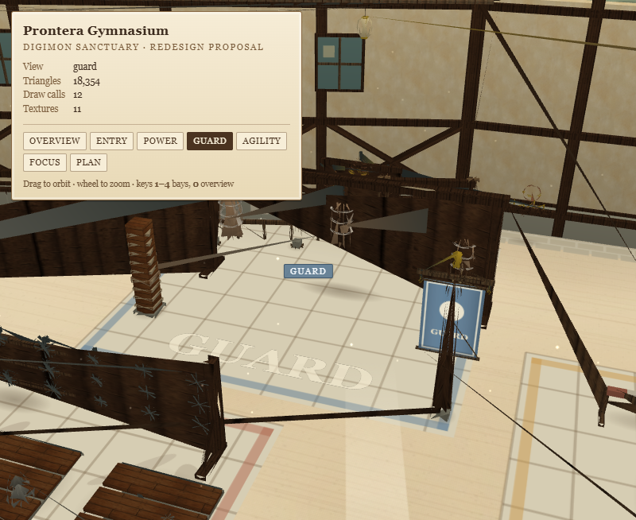
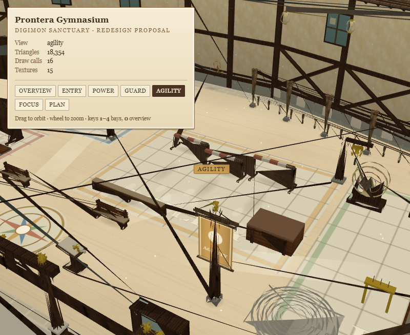
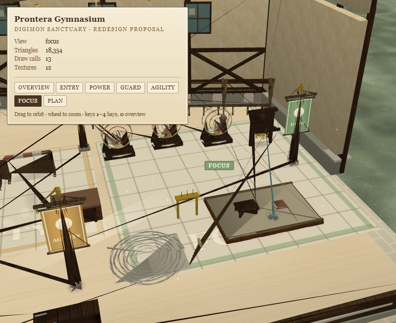
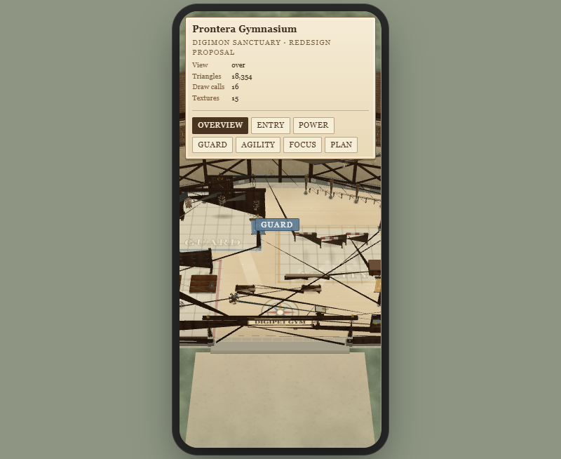
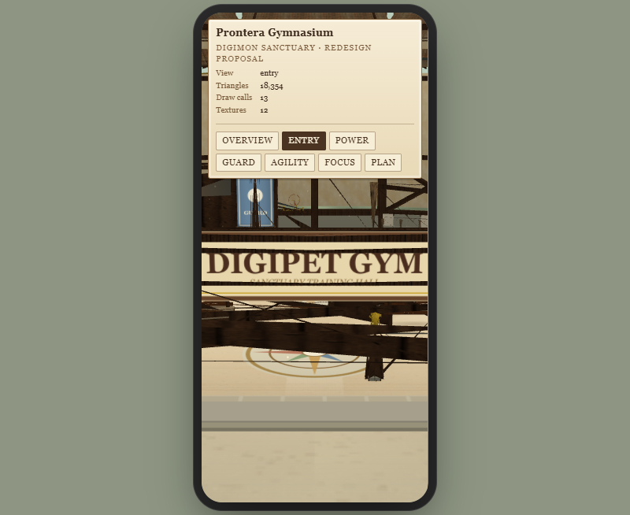

# Prontera Gymnasium - redesign proposal

**Status: proposal only. Nothing here is wired into the game, and none of it
ships until the owner approves it.** This is an interactive three.js art study
for the Digimon Sanctuary gym, built as a sibling to
[`../gym-asset-study`](../gym-asset-study/README.md).

The study answers a specific complaint from the v328-v360 rounds: the gym was
being improved in text and tiny props while the *place* still read as a labelled
pad. Here the enclosure, the sightlines and the four training modules are laid
out first, then dressed.



## What it is

A single scene that runs on the game's own renderer: **three.js r128**
(`../gym-asset-study/three.js`, already vendored for the asset study), the four
Sanctuary textures, and the real courtyard coordinates from
`assets/social-rules.js`. Flat-shaded `MeshBasicMaterial` with a baked key light
in vertex colour - the same pipeline the plaza uses - so the frames show what
the engine would actually draw, not a Blender render.

Measured on this scene at 800x654: **18,354 triangles, 18 draw calls,
17 textures, 18 geometries, no console errors or warnings.** That is cheaper
than most single character sprites and comfortably inside the mobile budget the
hub already holds.

## Run it

From the repository root:

```bash
python -m http.server 8792
# then open http://localhost:8792/docs/proposals/gym-redesign/
```

The page needs the repo root because it loads the four Sanctuary textures from
`assets/digimon/sanctuary/`. Deep links:

| URL | View |
| --- | --- |
| `?view=over` | wide overview of the whole courtyard (default) |
| `?view=entry` | approach through the gate |
| `?view=power` `?view=guard` `?view=agility` `?view=focus` | bay close-ups |
| `?view=top` | plan view |
| `&labels=0` | hide the bay chips |
| `&mobile=1` | 390x844 phone frame, for the mobile read |

Keys `1`-`4` jump to bays, `0` returns to the overview.

## Contract: what this does not change

The study is laid out inside the shipped courtyard, not a new one:

| Contract | Source | Kept |
| --- | --- | --- |
| Floor polygon `43,18.5 -> 65,12.5 -> 73,12.5 -> 95,18.5 -> 95,39 -> 43,39` | `gymShape` in `assets/social-scene.js` | yes |
| Five wall segments (two wings, connector, two returns) | `SANCTUARY_GYM_WALLS` | yes |
| Fence runs at `z = 38.5`, opening `x = 62..76` | `SANCTUARY_GYM_FENCES` | yes |
| Station rows: power `52.5/56.5/60.5 @ 30.5`, guard `60/63/66 @ 21`, agility `72/75/78 @ 26`, focus `83/86/89 @ 27` | `GYM_STATIONS` | yes |
| Gym session length, rewards, evolution rules | `assets/digimon-sanctuary.js` | untouched |

No new files outside `docs/proposals/gym-redesign/`, no new binary assets, no
change to collision, stations or the Worker. If the art is accepted, the swap is
a rewrite of the gym block in `assets/social-scene.js` plus a prop-collision
list - not a data migration.

## Design pillars

**1. Enclosure before decoration.** The shipped gym is a V of wall with two
labelled pads in front. This adds the parts that make it a building you can see
from the gate: a continuous veranda with turned posts, knee braces and balusters,
a connector roof at the wings' pitch, two closed side returns with stone
copings and buttresses, and a balustraded facade either side of the entrance.
The silhouette now reads from the camera's real 12-44 m orbit range.

**2. One apparatus per stat, legible at a glance.** Each bay is a distinct
module rather than a repainted circle:

| Bay | Module | Props |
| --- | --- | --- |
| **Power** | the Iron Yard | three sleeper platforms on the station row, a nine-slot plate rack with one slot empty, a sprung strike dummy, kettlebells, chalk bowl, hung towels |
| **Guard** | the Wall | a sandbag gantry with three patched bags and spilled sand, a bound guard post, a floor-standing buckler rack, a wall tool rack |
| **Agility** | the Run | three staggered hurdles, a leather-topped vault box, a balance beam, a ring bell on a post, painted footprints |
| **Focus** | the Still Pool | three straw archery butts with spent arrows, a raised meditation deck, a standing bronze bell, raked gravel, incense, a broom |

**3. Wear as storytelling.** The props are not pristine. One plate slot is
empty, a sandbag is patched and leaking, the notice board has a torn sheet, the
court paint carries broom sweeps, chalk dust, oil at the rack, a water ring by
the deck and two circulation trails worn from the gate to the bays.

**4. Light without lights.** There is no `DirectionalLight` and there are no
shadow maps. The key light from the south-east is baked into vertex colour at
build time, props get painted contact shadows, and the wall/floor join gets a
narrow ambient-occlusion band. The scene therefore adds zero lighting cost to
the hub and cannot change how the rest of the plaza looks.

**5. Walk where you fight.** Props sit off the station rows and off the gate
axis. The entrance keeps its full 14 m opening, the medallion marks the
threshold, and the four training rows stay clear from the court to the veranda.

## Frames

| | |
| --- | --- |
|  |  |
| **Entry.** Gate posts, fence wings, threshold slabs, sign and medallion. | **Plan.** Four bays around a clear central circulation spine. |
|  |  |
| **Power.** Plate rack, platforms, dummy; chalk and towels at the edge. | **Guard.** Sandbag gantry against the veranda, bucklers on their own rack. |
|  |  |
| **Agility.** Hurdles on the painted lane, vault and beam beyond. | **Focus.** Butts, gravel, deck and bell under the return wall. |
|  |  |
| **Phone, overview.** The four chips still read at 390 px. | **Phone, entry.** Gate framing holds. |

## Details that carry the read

- The court is a **painted canvas**, not a tiled texture: sand gradient, paver
  apron on the three open sides, pigment-banded bay pads, brass compass
  medallion at the gate, broom sweep, chalk dust, oil, water ring, contact
  shadows and an edge vignette, all generated once at load.
- **Festoon lights** hang from both veranda eaves on a real catenary, with paper
  lanterns, brass caps and iron brackets.
- **Banner masts** - stone base, turned mast, iron crossarm, brass finials - carry
  one cloth per bay, angled to face the gate.
- **Entrance** gets a balustraded facade, worn threshold slabs, a hanging sign
  and a queue line set to one side so it never blocks the opening.
- The **gate axes** line up with `SANCTUARY_GYM_FENCES`, so the facade and the
  collision the player already feels agree.

## Integration plan (if approved)

1. **Art swap.** Replace the gym block at `assets/social-scene.js` (the section
   that builds `gymShape`, the wing walls, the training props and the station
   markers) with the prop builders from `gym-redesign.js`. Keep
   `SANCTUARY_GYM_WALLS`, `SANCTUARY_GYM_FENCES` and `GYM_STATIONS` unchanged.
2. **Collision.** Add footprints for the rack, gantry, platforms, deck, butts
   and masts to the Sanctuary obstacle list; verify the gate and the four
   station rows stay reachable.
3. **Clearance.** The wing roofs pitch up to a ridge behind the back wall, with
   the rear eave at ~10.6 m. The six `behindGym` trees at `z = 10.2` are 6.8 m
   tall, so they pass under the pitch without clipping, but they will read as a
   covered grove behind the gym. Confirm that is wanted before porting.
4. **Life.** Hook the existing station markers to the live training animation
   (v360 already has the on-map clock), then the NPC/coach lines.
5. **Gates.** `tools/tests/digimon_sanctuary_sim.js` and
   `tools/tests/social_gym_sim.js` should extend their scene checks to the new
   props before the change leaves draft.

## Review status

Automated checks run against the study:

- zero console errors or warnings at every view, desktop and phone frame;
- geometry audit (`?audit=1`, 1,087 parts): nothing sits below the court plane;
  no loose prop leaves the courtyard envelope - only the shell's own roof
  overhangs and the gate threshold step project past the floor polygon - and
  the three ridges agree at 13.2 m;
- reachability audit: every station is clear at floor and body height. The
  six remaining AABB hits are false positives - the three stone weights at the
  corners of the lifting platforms, which are intended dressing, and the
  diagonal veranda beam at the three guard stations (its bounding box reaches
  the row; the real beam is 4.2 m away);
- connectivity audit: every freestanding prop chain resolves to the ground.
  The twelve components the AABB probe still reads as floating are all carried
  by `beamBetween` hardware it cannot see: the two gate-sign chains, the chalk
  stool, the bell-post bell and clapper, the three archery-butt legs, the
  broom, the barrel ladle and the two lantern strings;
- framing audit: all four courtyard corners and all four ridges project inside
  the frame at the overview and plan views; each bay view centres its bay;
- budget: 18.4k triangles (18,354), 18 draw calls, 17 textures.

**Not** verified: the visual judgement itself. This pass was made without a
human or vision-capable reviewer looking at the frames, so colour balance, prop
clutter and whether each bay reads as its stat still need the owner's eye. The
plan is to iterate on that feedback before anything is ported into the game.
