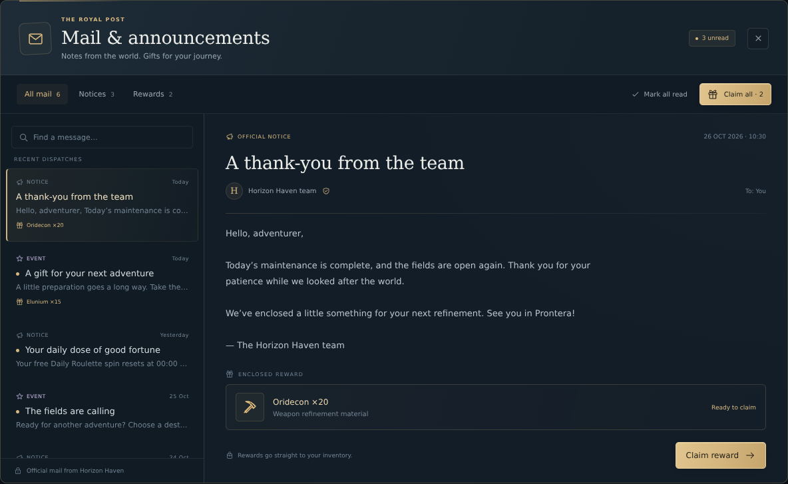
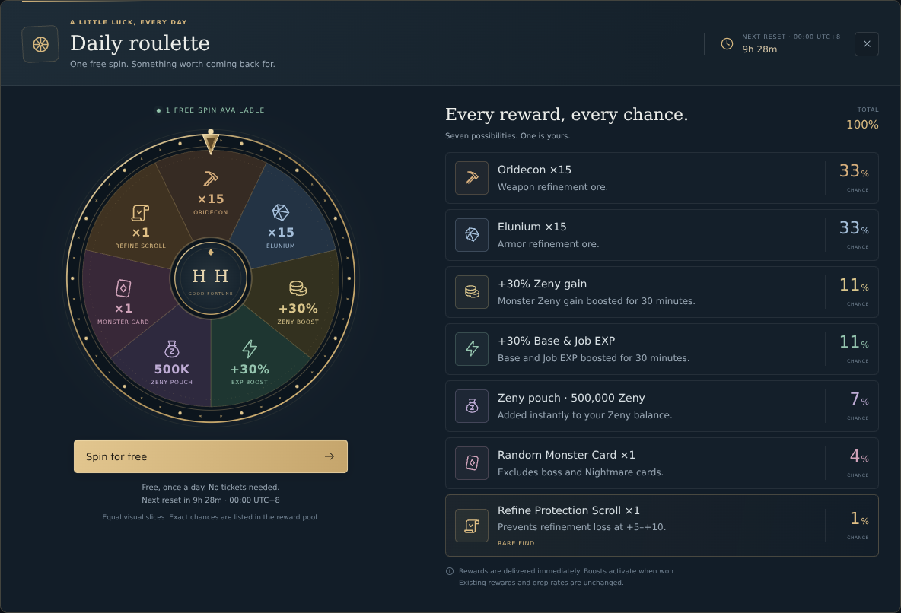
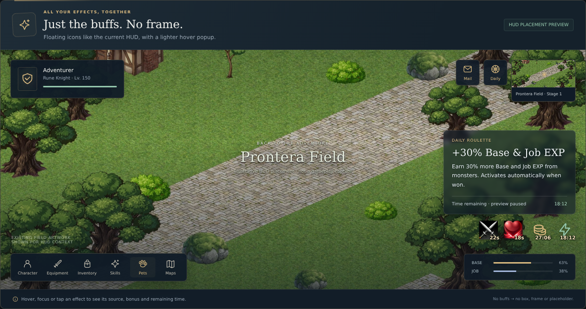
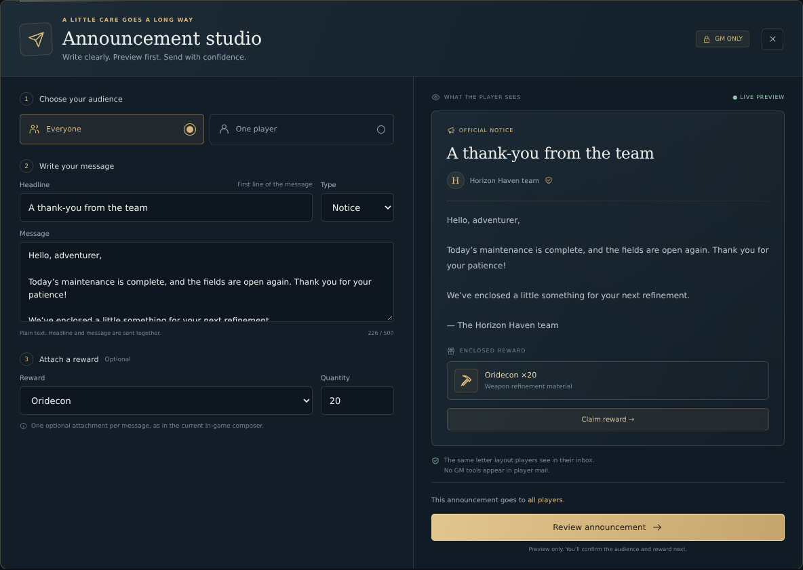

# The Royal Dispatch — mail, roulette & shared buffs

**26 October 2026 · Visual proposal, not applied to the game.**

A calmer version of the existing navy-and-gold Eclipse interface, with restrained fantasy details, clear headings and more room for reading. The in-game branding remains **Horizon Haven**; “The Royal Dispatch” is the design concept, not a game rename.

## Review the visuals

- **[Four-page visual proposal (PDF)](mail-roulette-proposal.pdf)**
- [01 — Mail](01-mail.png)
- [02 — Daily roulette](02-roulette.png)
- [03 — Shared buffs, translucent hover popup](03-shared-buffs.png)
- [Buffs active — floating icons only](03-floating-buffs.png)
- [No active buffs — nothing displayed](03-no-buffs.png)
- [04 — GM announcement studio](04-gm-studio.png)
- [Phone roulette, full scrolling layout](05-roulette-phone.png)

The screenshots are actual Chromium captures of the coded prototype, not AI-rendered interface concepts. The HUD view uses the game's existing field illustration for placement context; it is **not a running gameplay capture**.

### Open the interactive proposal

From the repository root:

```sh
PREVIEW_PAGE=tools/mail-roulette-proposal/index.html python3 tools/preview_server.py 8000
```

Open the preview's root URL. The named **Mail & roulette design proposal** live preview opens this page in Arena. The game is still accessible separately at `/game`; this prototype never boots it or changes a save.

The four top tabs are **presentation navigation**, not new player HUD tabs. Mail and Daily retain their existing in-game entry buttons. The **Phone** switch previews a 390px container; real narrow browsers adapt automatically.

## 1. Player mail



**Current problem:** a stack of full announcements and gifts shares a long feed with an open GM composer. Opening Mail also marks non-gift messages as read.

**Proposed:**

- Desktop: a compact 306px message index beside a dedicated reading pane.
- Filters: **All mail**, **Notices** (messages without attachments), **Rewards** (unclaimed gifts). Claimed gifts remain in All mail.
- Distinguish unread messages from unclaimed rewards instead of merging the two counts.
- A sender, type and date establish hierarchy; the letter body is fully readable.
- Place the attachment and claim action at the bottom of the letter. Keep “Claim all” distinct from “Mark all read.”
- Only opening an individual message marks it read; marking mail read does not consume a gift.
- Below 580px, use list → full-width letter → back, not two cramped columns.
- Player mail contains no GM form. A GM-only Compose entry should open the separate studio during integration.

## 2. Daily roulette



**Current problem:** `#mailDailyModal .mail-daily-card` is capped at 760px, `.roulette-stage` is 254px, and both `.rp-copy b` and `.rp-copy small` force ellipses. Two prize columns and the reserves panel compete for the remaining width.

**Proposed:**

- A roughly 1184px desktop panel at the 1440px review viewport.
- A 408px wheel stage at that viewport, about 61% larger than the current 254px stage.
- One full-width row per prize. Desktop labels are 14px, descriptions 12px, and rates have a dedicated right-hand column.
- Normal wrapping, growing rows and no ellipses for any reward name, description or rate.
- **Remove “Your reserves & active buffs” entirely.** Do not hide it in another roulette disclosure.
- Keep one clear free-spin action and a visible reset at 00:00 UTC+8.
- Below 780px the wheel and reward pool stack. The entire description stays available by normal vertical scrolling, not horizontal panning or tooltip-only text.
- Equal visual wheel sectors are explicitly labelled as decorative; they do not imply equal odds.

The reward fixture is pinned to the real `DAILY_WHEEL_SEGMENTS` in the browser test:

| Reward | Chance |
| --- | ---: |
| 15 Oridecon | 33% |
| 15 Elunium | 33% |
| +30% monster Zeny for 30 minutes | 11% |
| +30% Base & Job EXP for 30 minutes | 11% |
| 500,000 Zeny | 7% |
| 1 random non-boss, non-Nightmare Monster Card | 4% |
| 1 Refine Protection Scroll | 1% |

**No reward, drop-rate, spin-limit or reset-time change is proposed.**

## 3. Shared active-effects HUD



**Current problem:** `dailyBuffPill` lives under the Mail / Daily shortcuts, while `hudBuffs` contains pet effects at the bottom. One category of active effects has two homes.

**Proposed:**

- Put the roulette EXP and Zeny timers into the same lower HUD strip as pet buffs, above the command dock.
- Keep original pet buff artwork. Use restrained symbolic UI icons for EXP and Zeny, not replacement sprite art.
- **Owner revision:** keep the current floating-icon style. No panel background, border, heading, count, divider, tile frame or progress rail. Original pet icons remain 38px; transparent 44px hit areas keep them easy to tap.
- Each icon carries a small countdown. The popup stays closed until hover, keyboard focus or tap; it dismisses on pointer leave / keyboard blur, or outside tap / Escape when pinned.
- The popup uses a **65%-opaque dark background** with a light blur, instead of the previous nearly opaque surface. Text remains fully opaque and readable.
- Update timers in place. A surviving focused/hovered tile must not be recreated when its neighbour expires.
- Remove expired effects. Hide the entire buff region when empty, including any popup. **No empty-state box, message, label or placeholder** replaces it.
- No extra reserves/buff panel inside roulette and no timer pill beneath its HUD button.

**Integration constraint:** keep the existing clocks and mechanics separate. Roulette expiry comes from `dailyWheelState().buffs` / `dailyBuffLeftMs`; pet effects use `petBuff` and their existing combat tick. Combining their *presentation* must not change persistence, stacking, expiry, account ownership or combat.

## 4. GM announcement studio



**Proposed:** a dedicated screen, three steps and a player-side preview:

1. Choose the audience: everyone or one selected player.
2. Write a headline and plain-text message.
3. Add an optional attachment and quantity.
4. Review a confirmation listing the audience and per-recipient gift, then send.

The headline is the **first line of the existing body**, not a new database field. Its characters count toward the API's current 500-character limit. Old messages must remain readable without migration or lost text.

The prototype mirrors the current in-game material / Zeny options and one-attachment contract. Integration into `gm.html` must **retain its existing full equipment/card catalogue and permissions**; this proposal does not remove those capabilities. A live single-player picker must resolve the existing authorised player ID, not send the demo's free-text name as an ID.

Keep the draft on cancel or send failure, prevent double submission, and show the server's actual pending/error/success result. The prototype demonstrates confirmation and cancellation, **not server authorisation or delivery**.

## Prototype boundaries

- All messages, claims and GM sends are synthetic, in-memory examples. Reload or **Reset demo** restores the fixtures.
- No API requests, account access, `S` mutation, localStorage persistence, real rewards or real broadcasts.
- The spin is deliberately scripted to show the EXP win. It is not a random-roll simulation and never grants gameplay currency.
- Demo buff timers start **paused** so the owner can inspect them. “Start demo timers” and “Expiring soon” demonstrate countdown and removal.
- Actual runtime files (`index.html`, `gm.html`, `assets/`, `functions/`, migrations) are unchanged. There is no `BUILD` bump because no player-facing runtime change has shipped.
- Everything new lives under `tools/` and `docs/`, excluded by the existing static-site assembly / asset-ignore rules.

## Pinterest references

The fantasy mailbox reference informed the separation of categories and reading space; the wheel references informed the large central wheel and clear spin action. The implementation is original and adapts those ideas to the existing theme, rather than copying their art. [1](https://www.pinterest.com/pin/315111305155016551/) [2](https://in.pinterest.com/pin/spin-wheel-game-ui-in-2024--44543483810163030/)

- [1](https://www.pinterest.com/pin/315111305155016551/) — League of Angels, Mail system.
- [2](https://in.pinterest.com/pin/spin-wheel-game-ui-in-2024--44543483810163030/) — Spin Wheel Game UI, Himanshu Rawat.
- [3](https://www.pinterest.com/ideas/spin-wheel-ui-design/953971608209/) — wheel-reference collection; search image previews were inspected.

Direct Pinterest page retrieval returned HTTP 403. Search-indexed descriptions and image previews were available; no unviewed full board is being claimed as reviewed. Third-party reference images are not redistributed in this proposal.

## Files & verification

- `tools/mail-roulette-proposal/index.html` — interactive review shell.
- `tools/mail-roulette-proposal/proposal.css` — scoped prototype styling.
- `tools/mail-roulette-proposal/proposal.js` — local demo interactions and fixtures.
- `tools/mail-roulette-proposal/review.html` — four-page printable visual review.
- `tools/check_mail_roulette_proposal_browser.cjs` — browser checks and capture/PDF generation.

Install browser dependencies together so npm does not prune the repository's optional test packages:

```sh
npm install --no-save --package-lock=false playwright @sparticuz/chromium jsdom three@0.128.0 ws
node tools/check_mail_roulette_proposal_browser.cjs http://127.0.0.1:8000 --capture
```

The browser runner loads the Chromium shared libraries bundled in its npm package. `--capture` regenerates the seven published PNGs and the four-page PDF. Temporary full-page review screenshots and the detailed report go into locally ignored `.arena/ui-review/`.

**Verified after the frameless-buff revision:** 17 browser checks; 20 screen/viewport combinations at 320, 390, 768, 1280 and 1440px; no horizontal overflow, clipped reward descriptions, page errors or failed asset requests. Checks cover mail search/read/claim, duplicate protection, a scripted spin, shared effect placement, frameless icons, a completely invisible empty-buff state, translucent hover/dismiss behavior, stable focused timers and expiry, safe GM preview, the 500-character budget, recipient/quantity validation, confirmation/cancel, keyboard tab navigation, phone drill-in/back and absence of save/API writes.

Existing suites also passed: `ui_sim.js` (64), `eclipse_ui_sim.js` (52), `gm_console_sim.js` (12), `display_polish_sim.js` (10), `update_watch_sim.js` (9). `bash tools/build_site.sh` completed, and explicit checks confirmed that no proposal tool, document or capture enters `dist/`. The generated PDF was verified to contain exactly four pages. This is a proposal review, not production integration, actual cloud delivery or physical-phone performance testing. For the requested pull request, the full pre-push gate was also run: all three generated-asset checks passed; the 136 simulation/smoke suites finished with **129 passed, 7 known failures, no skips and no new failures**, matching the [documented baseline](../../TESTING.md#the-known-red-baseline-measured-2026-10-26). The seven existing failures are `field_loop_smoke`, `ground_combat_sim`, `rotation_updates_sim`, `skill_redesign_sim`, `fourth_job_skills_sim`, `skill_balance_sim` and `publish_sim`. The proposal browser check was rerun and remains 17/17. This delivery still does not integrate or deploy the UI into the game.

## If approved

Apply the chosen presentation to `renderMailView`, `renderDailyRouletteView`, `renderMailDailyModal`, the GM composer and the shared HUD render/update paths. Keep original claim receipts, cloud sync and reward calculation functions. Remove the old `dailyBuffPill` presentation and reserve-panel markup; do not remove their underlying saved balances/effects.

Use viewport-bounded dialogs with sticky headers and scrollable content in the real game, so short-height desktops can still reach every row and action. The review page deliberately scrolls as a document for easy design inspection. Update the existing mail/roulette/pet-buff regressions alongside new responsive/focus tests, verify cloud error cases, bump all four build mirrors, and append the integration entry only when those runtime changes are actually made.
