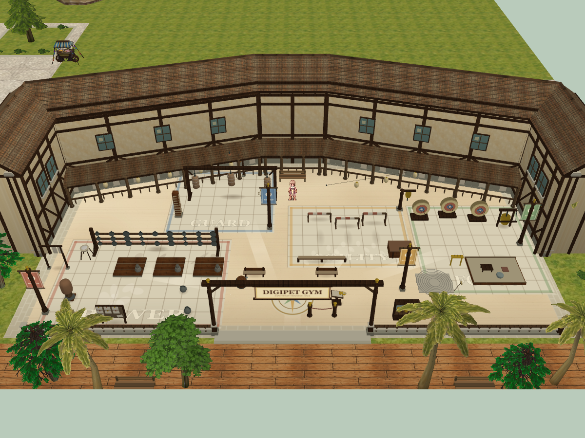
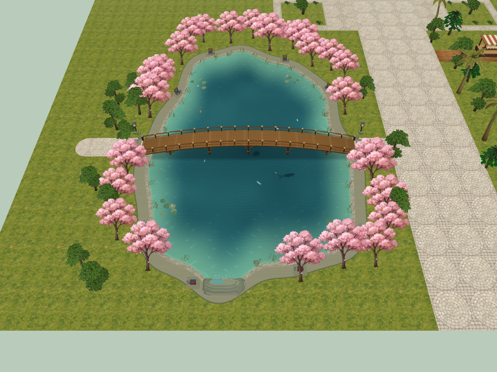
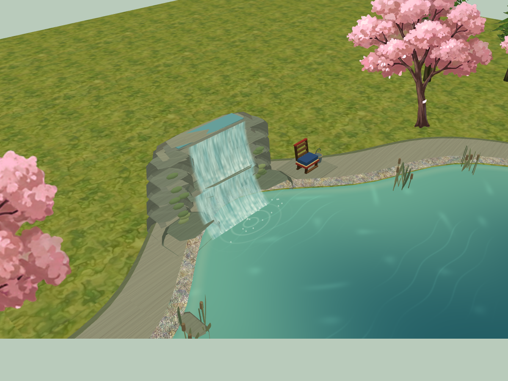

# Social Hub art revision — gym and Sakura Reach

Draft PR #187. Source snapshot: GitHub `main` at
`28c99a39cca290ee8f64366c63b61b8a4b2e140f` (18 commits newer than the original
arena base). No local clone was used as the source of truth.

## Gym

Continuous pitched roofs now cover the left return, both rear wings, the center
and the right return. The center veranda is closed, side interiors have timber
frames/windows/sills, and the entrance board is raised 2.1 units with its supports.
The reviewed court and training props are retained.

## Pond

The repeated ring of faceted rocks was removed. The original limestone coping
texture is retained, with a quieter promenade and sparse planted-inlet accents.
The bridge has a shared-profile arched deck, trestles, braces, rail joints and
landing masonry. Its walking height follows the existing game formula.

The cascade has a source basin, layered rock ledges, two connected water drops,
moving flow detail, instanced splash droplets and spreading impact ripples.
Jade water has shallow/deep color, broken highlights and a bridge contact shade.
Its opaque base remains complete when animated highlights are disabled.
Reeds, lotus flowers, tackle buckets and lantern fittings add small details.
The existing swimming fish, shark/octopus silhouettes and supplied sakura sprites
remain in the game's scene.

## Review approach

Used the installed `3dviz-pro-max` object-construction and visual-review guidance
and its `knowledge.material-water-surface-cues` record. Geometry/materials are
custom three.js work with existing project textures; no new runtime image assets.

Actual game overview, entrance, roof, bridge and cascade renders were reviewed.
Iterations corrected a three.js-r128 geometry API mismatch, missing roof sections,
roof/wall gaps, repeated shore rocks, overly striped waterfall flow and noisy
large rock surfaces. Automated geometry checks are evidence of coverage and
clearance, not an artistic-quality certificate. This remains a stylized game-art
revision for owner approval, not a claim of photorealism or certified AAA quality.

## Runtime and synchronization

- `assets/social-gym-redesign.js`: generated from the gym study.
- `assets/social-pond-design.js`: pond art builder and uniform/instance animation.
- `assets/social-scene.js`: narrow integration hooks over the latest scene.
- `assets/social-rules.js`: added collision only for the enclosed gym shell;
  fishing seats, lake shape and bridge/navigation contract are retained.
- BUILD and three mirrors advance together to haven-v370; Social asset URLs are
  cache-busted together.
- Pages and the Social Worker must use this same shared rules version.

PR synchronization uses a GitHub Git Data API commit whose tree starts at the
latest `main` and overlays only these reviewed files and the existing gym study.
Both the previous PR head and latest `main` are parents, retaining review history
without force-pushing. Before publishing, recheck both remote refs; stop if either
advanced. Keep the PR draft and do not merge it automatically.

See `validation.md` for measured checks and outstanding baseline failures.
