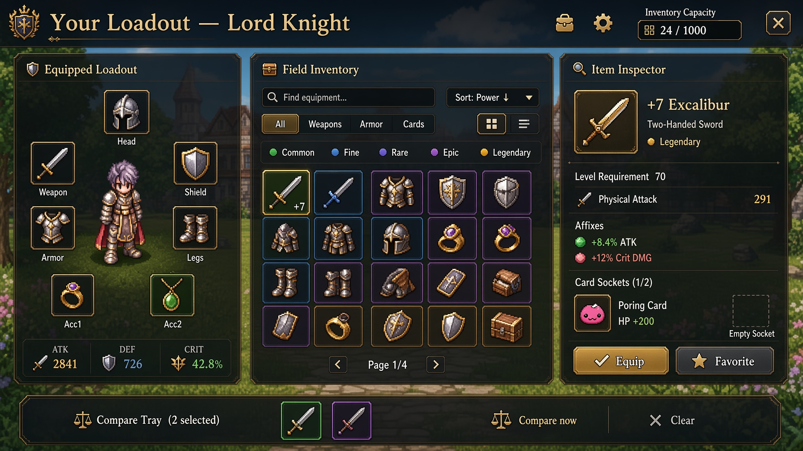
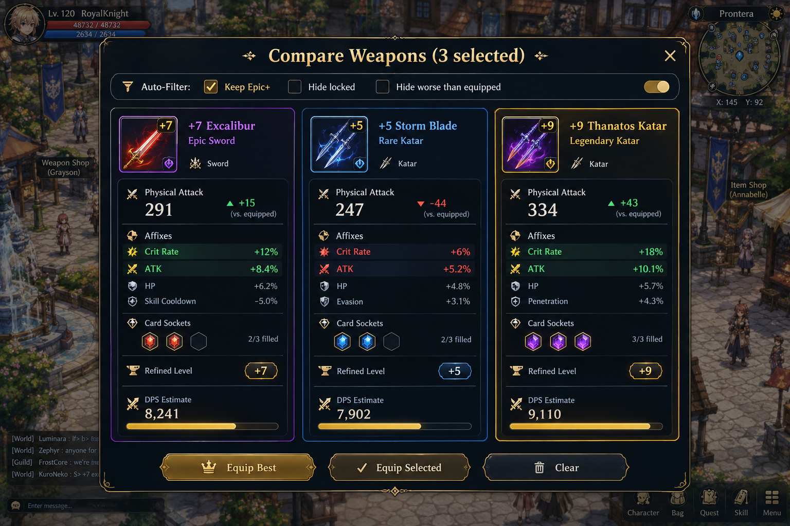
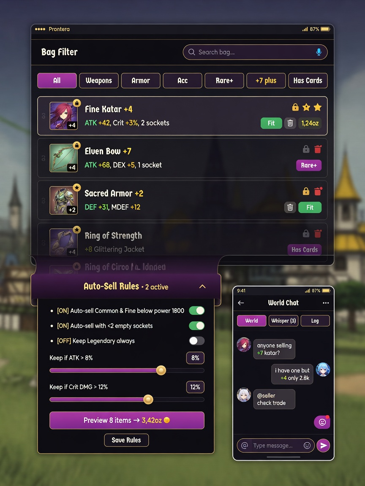
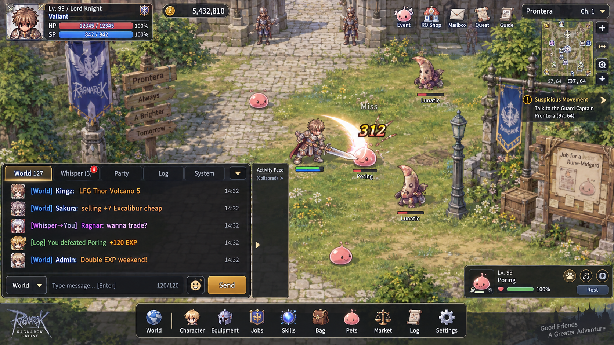

# Prontera Grind — Equipment & Chat Redesign Proposal
**Branch:** `arena/fc9c4514-prontera-grind` · **Date:** 2026-10-20 · **Author:** Arena Agent for Johor Bahru build

You asked for two things:

1. **A more user-friendly Equipment tab** — easier weapon comparison, search, auto-delete & filters
2. **World Chat + Whisper (PM) live together with the Log tab** on the main screen

This folder contains: **4 picked visuals + 2 live interactive prototypes** you can click through. All designs keep your current Eclipse dark-glass language, 7-slot loadout, and field panorama — nothing is re-skinned.

---

## 1) Equipment Tab — what changes, why, and how it works

### Current pain (from your live game)
- **Compare is hidden:** you tap a slot → fitting items turn green → you must remember stats between taps. No side-by-side.
- **Search is rarity-only:** `All | Rarity` + a single text input. No slot filter (Weapons vs Armor), no sort, no “keep only +7 or better”.
- **Bag grid is grid-only:** 30 tiles, paginated, same size for a Lv 1 Common and a Lv 150 Legendary. Affixes, sockets, and “worse than equipped” are invisible until you hover.
- **Auto-sell is a disclosure:** buried under `Bag → Bag tools → Auto-sell & bulk sell`. Rules need manual JSON-like editing; preview is a text list. New players miss it and drown in Commons.

### Proposal — 3-pane workbench + sticky Compare Tray

```
┌─ Equipped Loadout (sticky) ─┬─ Field Inventory (scroll) ─┬─ Item Inspector (sticky) ─┐
│ 7 slots around hero sprite  │ Search [Find equipment…]   │ +7 Excalibur · Legendary  │
│ ATK/DEF/CRIT live totals    │ Chip filters: Weapons…     │ ATK 291 · +7 refine incl. │
│ Weapon compatibility hint   │ Rarity pills (multi-select)│ Affixes + deltas vs equip │
│                             │ Sort: Power ↓ · Recent ·   │ Sockets 2/3 · Cards       │
│                             │ View: ▦ Grid | ☰ List      │ [Equip] [Lock] [Sell]     │
└─────────────────────────────┴──────────────────────────────┴───────────────────────────┘
  └──────────────────────── Compare Tray (2 selected) [Compare now] ────────────────────────┘
  └──────────────────────── Auto-Sell Rules sheet ─────────────────────────────────────────┘
```

**Visual — desktop workbench (picked):**



**What you get in the center column:**
- **Search that understands you:** `excal`, `+7`, `crit 12%`, `poring card`, `2 sockets empty` — one field, debounced, highlights matches in tiles.
- **Filter chips you can stack:** `All / Weapons / Armor / Legs / Acc` + `Weapon Type: Sword / Katar / Dagger / Bow…` + `Rarity: multi-select` + `Refine: +0…+15 slider` + `Has affix: ATK / Crit / CDM…`. Chips stay visible, removable with ×. “Worse than equipped” is a toggle that dims non-upgrades instead of hiding them.
- **Sort + view:** `Power ↓`, `Recent`, `Name A→Z`, `Value ↓`, `Refine ↓`. Grid for browsing, **List for comparing** — list shows one row per item: icon · name · `ATK 291 (+44)` · `Crit 12% (+3%)` · sockets `◆◇` · refine `+7` · value · lock/star.
- **Pagination stays, but is smarter:** 30/page, page state remembers filters. “Show new drops (8)” jumps to new items without losing scroll.

**Right inspector — no more modal hopping:**
- Selecting any tile (grid or list) paints the inspector instantly. It shows **deltas vs currently equipped**: `ATK +44 ▲`, `CRIT +3% ▲`, `DPS est. +312 ▲`. Red/green arrows, not just numbers.
- One-tap **Lock (★)** protects from auto-sell. **Equip** swaps with animation. **Sell** shows Zeny before confirm.

**Bottom Compare Tray — the core ask (“easier to compare weapons”):**
- Checkbox on each inventory tile → up to **3 items** pinned to tray (weapons, or any slot). Tray is sticky, shows thumbnails + rarity border.
- **Compare now** opens overlay (see next visual). Same tray works on mobile as a bottom sheet.

**Visual — compare overlay (picked):**



> Overlay shows 3 weapons side-by-side with true deltas, DPS bar, and socket comparison. On mobile it becomes a horizontal swipe.

**Overlay details:**
- Each column: icon, name, rarity, refine, sockets, affixes, `Physical Attack` big number, `+15 / -44` delta badge, DPS estimate with bar, “Upgrade?” hint (“Keep — higher ATK but loses 1 socket”).
- Buttons: `[Equip This]` per column, `[Equip Best (DPS)]` auto-picks, `[Clear]`.

**Auto-delete / Auto-filter — rebuilt as “Auto-Sell Rules” (your “auto delete & filter”):**
- Lives as a **sheet** under the inventory, not a collapsed `<details>`. Three presets: `Farming (keep Rare+ only)`, `Boss (keep Epic+ +7)`, `Collector (keep all)`.
- Rule builder (no JSON):
  ```
  IF  rarity IN [Common, Fine]      → Sell
  AND emptySockets < 2             → Sell
  AND maxAffixValue < 4%           → Sell
  BUT IF name IN [Excalibur,…]     → Keep
  BUT IF refined >= +9             → Keep
  BUT IF locked ★                  → Keep
  ```
  Each row: dropdown `rarity / emptySockets / affix / weaponType / refined / name` + operator + value + `Keep/Sell` toggle. Add row with `+ Add condition`.
- **Live preview:** `Preview 18 items → +7,840z, 3 kept (Locked, +9, Named)`. Items that would sell are flagged in grid with a small `$` badge; locked items never flag.
- **Bulk sell** re-uses same rules: pick rarities + run preview → confirm. No second UI to learn.

**Mobile — list is king:**



- Phone defaults to **List view** (row with icon, name, 2-line stats, value, lock/trash). Grid is a toggle.
- Filter chips become a horizontal scroll row. Search sticks to top.
- Auto-Sell sheet is a bottom drawer with big toggles — thumb reachable.

**Why this respects your saves:** all logic is client-side on `S.inv`. No new save fields except `eclipseCompareTray` (array of up to 3 ids, transient) and `autoSellRules` which already exists — we just give it a proper UI. Existing `autoSell` boolean array maps to the new rarity multi-select.

---

## 2) World Chat, Whisper (PM) + Log — together on the main screen

### Current
- `Log` lives alone in `#feedWrap` bottom-left: 3–5 white lines over grass, tab `📃 Logs ▾`. World chat does not exist; whispers do not exist. Log filters require opening the `Log` window.

### Proposal — one Comms Dock (≈ 380×220px, collapsible)

**Visual — main screen with Comms Dock (picked):**



**Placement:** replaces/enlarges `#feedWrap` bottom-left. **Does not move `#dock`** (skill bar) or `#hud`. Three states: **docked (≈220px tall) · minimized (bar only) · focused (expanded to 380px)**. Drag handle to resize; state saved per device (`localStorage pg_chat_size`).

**Tabs (segmented control, not dropdowns):**
```
[ World 127 ● ] [ Whisper 3 ● ] [ Party ] [ Log ] [ System ]
   14:32 Kingz: LFG Thor Volcano 5
   14:32 Sakura: selling +7 Excalibur 12k
   → You to Ragnar: wanna trade? (whisper tab, blue)
   Log: You defeated Poring +120 EXP (dim)
```
- **World:** global, cross-map. Rate-limited (1 per 2s, 120 chars). Player names color by rarity/title; `/w Name message` also works in World to whisper.
- **Whisper:** PMs. Unread badge `(3)` on tab, red dot on dock icon. Click name in World → whisper prefill. `/r` to reply, `/w Name` autocomplete from recent. Tabs per conversation optional; v1 is single Whisper feed with `→ You to X` / `X → You` lines.
- **Log:** your existing combat/loot/system feed, now filtered by the same tabs. Turning off a log category in `Log` window instantly hides it in dock — one setting.
- **Party** reserved (disabled chip “Coming Soon”) so layout never shifts later.

**Input bar:**
```
[Channel: World ▾] [ Message...                         ] [ Send ↵ ] [ 120/120 ]
```
- Enter to send; Shift+Enter newline; Tab to switch channel; `@Kingz` mentions highlight. `/clear`, `/whisper`, `/mute`, `/block` commands. Profanity filter client-side; server can extend.

**Unread & toast:**
- While dock is minimized, new World/Whisper flashes a **toast** above dock for 3s: `Whisper from Ragnar: wanna trade? [Open]`.
- Log never toasts (to avoid spam). World toasts throttle to 1 per 10s; Whisper always toasts.
- Sound toggle in `Settings → Display` (respects your existing `S.sfx` / `BGM` pattern).

**Moderation & safety (server side):**
- World messages go through Cloudflare Worker `api/chat` → KV rate limit + wordlist + report button. Whisper is `api/whisper` with block list stored in `player_gm_notes` or new `player_blocks`. Log lines never leave device.

**Why “together with Log”:**
- One scroll, one search (`Filter messages…`), one resize handle. Players in idle games glance bottom-left constantly — splitting Log and Chat across opposite corners forces eye travel. The segmented tabs keep the muscle memory of `📃 Logs ▾` while adding World/Whisper without a second panel.

**Mobile:** chat input docks to bottom with safe-area inset; tabs become a swipeable pill row; input gets a `[Chat]` FAB that expands the dock when minimized.

---

## 3) How the two pieces support each other

- **You see a drop → compare → chat:** select 2 swords → `Compare now` → see `Thanatos Katar +9 is +44 ATK` → `[Share to World]` copies `WTS +9 Thanatos Katar ATK 334 — DM offers` into World input.
- **You tune auto-sell → less spam → better log:** auto-sell dimmed items get `hidden from Log` toggle so Log shows only keeps and Epic+.
- **New player flow:** first 10 drops show a coachmark `Tip: Pin 2 weapons to Compare` and `Try Auto-Sell: keep Rare+`.

---

## 4) What’s unchanged (house rules)

- No new art: icons stay `assets/equipment-icons/*.png` + `icon()` + `RO_ITEM_ICON_CANDIDATES`. No recolored hero.
- No save break: new prefs are device-local (`pg_chat_size`, `pg_chat_channel`) or map to existing `S.autoSell` / `S.autoSellRules`.
- Performance: chat is a capped ring buffer (200 World, 100 Whisper, 200 Log lines). Oldest pruned; DOM patched via `eclipsePatch`, same path as your current `renderWin`.

---

## 5) Next steps — your call

**Option A — Approve visuals as-is → I implement in `index.html`:**
- Equipment: search+chip filters, sort, grid/list toggle, 3-item Compare Tray + overlay, delta inspector, Auto-Sell Rules sheet with preview.
- Chat: replace `#feedWrap` with Comms Dock (World/Whisper/Log tabs, input, autocomplete, toast, unread badges). Stub `api/chat` worker for local preview; wire to real worker when you provide endpoint.

**Option B — Tweak then build:** tell me what to change:
- “Make Compare 2 only”, “Add DPS column in List”, “Hide Log from Chat”, “No toast”, “Force light theme”, etc. I’ll regenerate the affected visual in one turn.

**Option C — Prototype only:** keep current game untouched, ship the two HTML prototypes in `proposals/…/interactive/` as a clickable spec for your team.

---

## 6) Files in this folder

- `01-equipment-redesign-desktop.png` — 3-pane workbench + Compare Tray (desktop)
- `02-weapon-compare-overlay.png` — 3-weapon compare modal with deltas/DPS
- `03-chat-log-integration.png` — main screen World/Whisper/Log dock
- `04-mobile-autofilter-chat.png` — mobile list + Auto-Sell drawer + chat pills
- `interactive/equipment.html` — click-through equipment prototype *(next)*
- `interactive/chat.html` — click-through chat prototype *(next)*
- `README.md` — this file

---
*Built on v2 Eclipse concept by the same dark-glass system. All original game assets retained.*
